# 转转选机助手 · v1

**当前预发布版本为 1.2.0-beta16。** 从转转首页或商品列表发起任务，按型号、待售手机的 iOS 版本、购买渠道、容量、成色和验机报告筛选。命中后可以暂停核对，也可以保存记录、按设置收藏并继续扫描。

[下载 beta16](https://github.com/bingdilian/zz-picker-public/releases/tag/v1.2.0-beta16) · [版本记录](docs/public/CHANGELOG.md) · [问题反馈](docs/public/feedback.md)

## 功能介绍

- **基础筛选**支持设置待售手机的最低和最高 iOS，含上下限，留空的一侧不限。购买渠道默认国行，渠道、容量和成色支持多选。同组满足任一选项即可，不同条件组须同时满足。
- **验机报告筛选**在基础条件之后，依次核验维修浸液、屏幕、设备功能、电池和外观。必要字段缺失、冲突或无法核对时列为「待确认」，不触发自动收藏。升级时保留已有筛选范围。
- **任务与记录**支持暂停、继续和结束。命中记录按「全部 / 已收藏 / 待处理」查看，保留最近 10 次有命中的任务。「筛选核验记录」可查看待确认或排除原因，并通过「查看详情」打开对应商品复核。
- **自动收藏**在确认商品命中后按开关执行，独立回读同一商品确认已收藏才记为成功。收藏未确认时保留命中记录。开启「命中后继续扫描」后，当前收藏流程收尾再处理下一件。

| 验机报告筛选 | 可设置的条件 |
|---|---|
| 外观 | 不限、允许划痕／磕碰／掉漆或磨损且其余适用项通过、排除指定外观 |
| 电池情况 | 更换情况可多选，可填写最低健康值和最多充电次数，留空不限 |
| 屏幕 | 不限、显示和触控全部通过、排除指定问题 |
| 设备功能 | 不限、全部通过、指定功能必须通过 |
| 维修浸液 | 不限、全部通过、指定情况 |

指定模式只检查勾选项，全部通过模式检查报告中的适用项目。beta16 修正了「零件缺失」小项的识别。报告明确写「未检出缺失」且平台标记正常时判为通过。「平台已拆机检测」和「平台未拆机检测」在标记正常且文案一致时按检测说明处理。「平台已拆机换电」属于另一种报告结果。

## 使用说明

### 下载与安装

先结束任务、完全关闭转转，再用原安装方式移除旧版。每次只使用一种安装方式，装好后重开转转，在「选机设置 → 说明 / 环境」核对版本和编译变体。

| Release 文件 | 怎么用 |
|---|---|
| [TrollFools dylib](https://github.com/bingdilian/zz-picker-public/releases/download/v1.2.0-beta16/ZZPicker-1.2.0-beta16-trollfools.dylib) | 保存到 iPhone 的「文件」，打开 TrollFools，选择转转，导入并注入 dylib，再重开转转。这是已有真机实践的方式。 |
| [TrollFools zip](https://github.com/bingdilian/zz-picker-public/releases/download/v1.2.0-beta16/ZZPicker-1.2.0-beta16-trollfools.zip) | 在「文件」中解压出 `ZZPicker.dylib`，然后按上一行注入。压缩包直接导入方式需自行验证。 |
| [rootless deb](https://github.com/bingdilian/zz-picker-public/releases/download/v1.2.0-beta16/ZZPicker-1.2.0-beta16-rootless.deb) | 普通 Dopamine 无根环境使用。把 deb 交给对应环境的包管理器安装，按提示操作后重开转转。需自行验证。 |
| [RootHide deb](https://github.com/bingdilian/zz-picker-public/releases/download/v1.2.0-beta16/ZZPicker-1.2.0-beta16-roothide.deb) | Dopamine RootHide 环境使用。用该环境的包管理器安装，按其规则允许转转加载插件，再重开转转。需自行验证。 |
| [完整分发合集](https://github.com/bingdilian/zz-picker-public/releases/download/v1.2.0-beta16/ZZPicker-1.2.0-beta16-release.zip) | 解压后按环境选一种安装文件。内含源码、文档、截图和校验清单。 |
| [项目源码包](https://github.com/bingdilian/zz-picker-public/releases/download/v1.2.0-beta16/ZZPicker-1.2.0-beta16-source.zip) | 用于阅读、修改和构建。GitHub 自动生成的两个 `Source code` 压缩包也用于获取源码。 |
| [SHA256SUMS](https://github.com/bingdilian/zz-picker-public/releases/download/v1.2.0-beta16/SHA256SUMS) 与 [合集校验文件](https://github.com/bingdilian/zz-picker-public/releases/download/v1.2.0-beta16/ZZPicker-1.2.0-beta16-release.zip.sha256) | 前者用于核对清单内的文件，后者用于核对完整分发 ZIP。 |

TrollFools 安装的版本从 TrollFools 移除，deb 安装的版本从对应包管理器卸载，完成后重开转转。[安装与卸载细节](docs/public/install.md)

### 开始筛选

1. 从首页或商品列表点「选机设置」，输入完整型号，填写目标 iOS 范围，按需选择购买渠道、容量和成色。
2. 打开「验机报告筛选」，设置五类条件，点右上角「应用筛选」。可以先只设基础条件跑一轮，再按实际需求收紧验机条件。
3. 设置处理件数和有效运行时间，默认 **100 件 / 15 分钟**，范围为 **1–2000 件 / 1–120 分钟**。暂停和查看命中详情不计入有效运行时间。
4. 点「开始搜索并扫描」，保持转转前台。首次使用可先关闭自动收藏，核对命中和排除记录后再开启。
5. 在「命中记录」查看结果，或在「筛选核验记录」点开原因并进入原商品详情。已有任务沿用启动时的设置，调整条件后用新任务验证。

需要连续扫描并自动收藏时，开启「自动加入收藏」和「命中后继续扫描」。若也允许插件确认平台焕新电池提醒，再开启默认关闭的「允许自动确认换新电池提醒」。插件只在当前商品实际出现该弹窗时点击一次「知道了，继续收藏」。如果验机筛选已排除平台换电商品，开启自动确认也不会让它进入收藏流程。

## 真机实践

| 项目 | 已有真机记录 |
|---|---|
| 运行插件的手机 | iPhone 13 Pro Max |
| 手机系统 | iOS 15.4.1 |
| 转转 App | 12.8.5 |
| 注入方式 | TrollFools 直接注入 `.dylib` |
| 截图中的选机目标 | iPhone 15 Pro Max |

下面是 2026 年 11 月 5 日提供的真机界面。截图里的 iOS 26–27.0.1 是待售商品筛选范围，运行环境来自诊断记录。截图展示了五类筛选、收藏回读和详情复核，插件构建号以「说明 / 环境」和诊断为准。

### 实际截图

| 选机条件 | 扫描与收藏设置 |
|---|---|
| 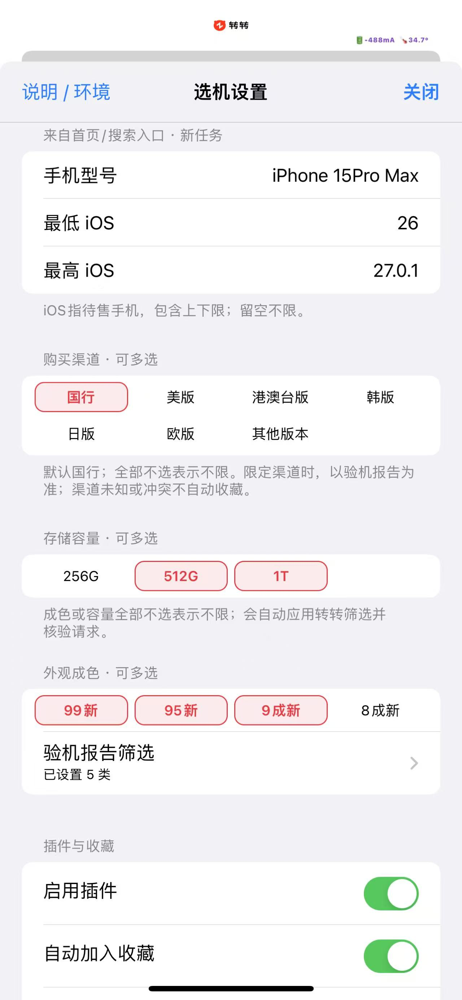 | 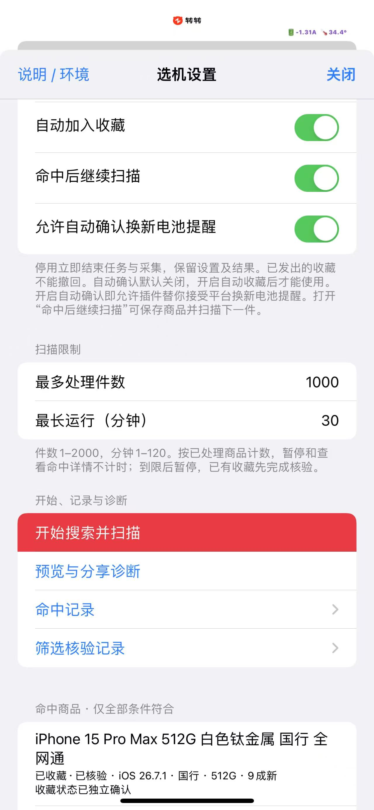 |

| 命中记录 | 已收藏记录 |
|---|---|
| 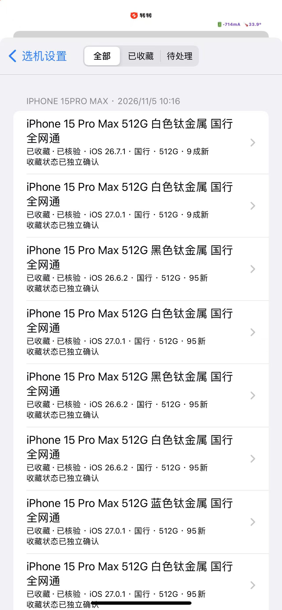 | 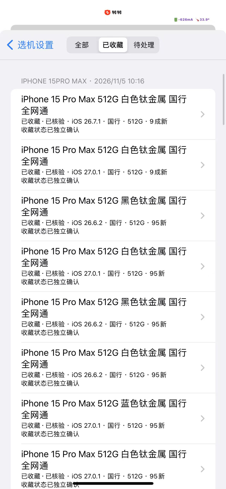 |

| 筛选核验记录 | 转转商品详情 |
|---|---|
| 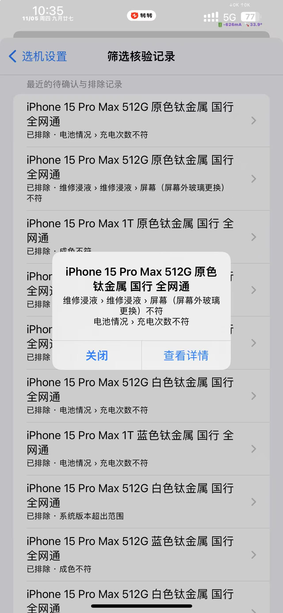 | 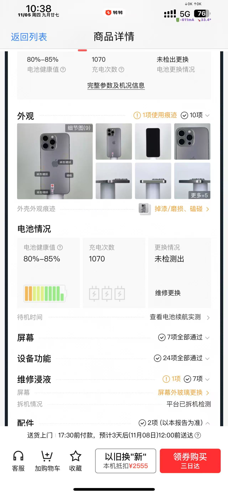 |

这组复核截图中，商品报告显示「屏幕外玻璃更换」、充电 1070 次。对应任务要求维修浸液全部通过、最多充电 1000 次，记录列出了这两项排除原因。

查看验机报告筛选的 8 张设置截图

| 外观模式 | 可排除的外观项目 |
|---|---|
| 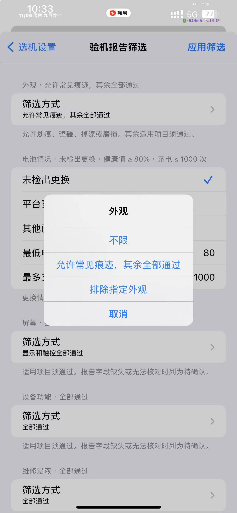 | 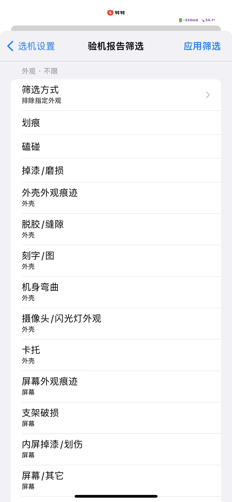 |

| 屏幕模式 | 可排除的屏幕问题 |
|---|---|
| 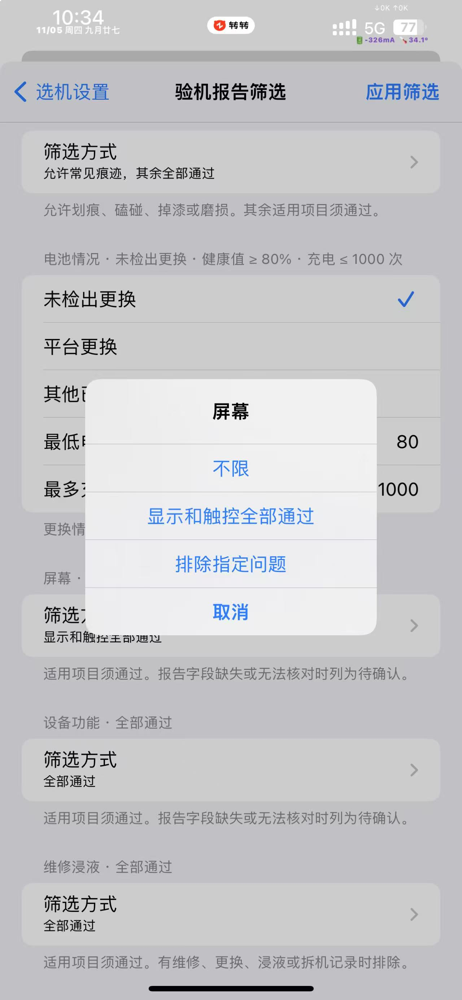 | 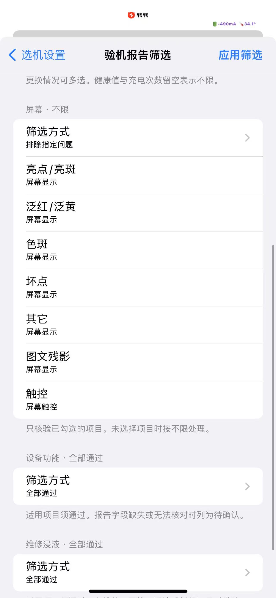 |

| 设备功能模式 | 可指定的设备功能 |
|---|---|
| 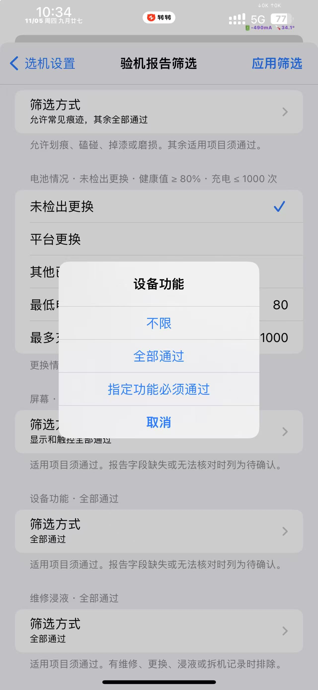 | 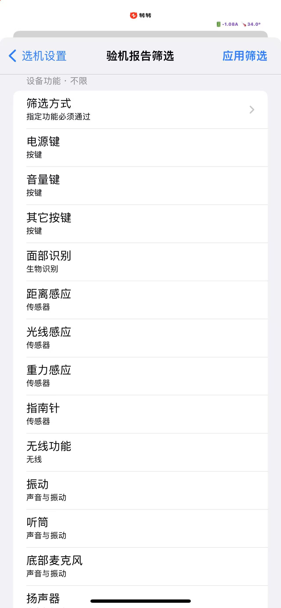 |

| 维修浸液模式 | 可指定的维修浸液项目 |
|---|---|
| 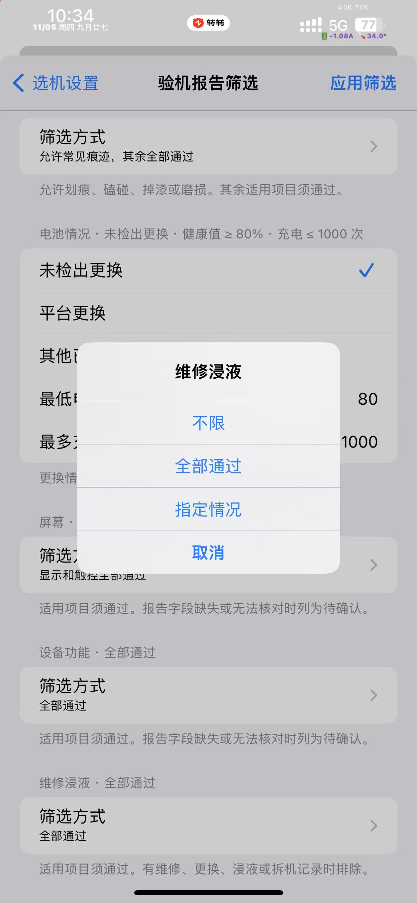 | 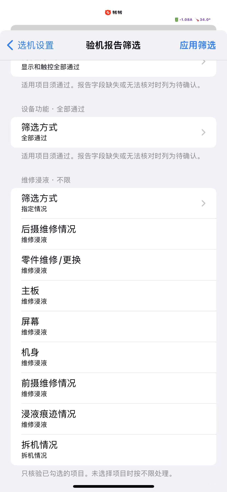 |

## 其他注意事项

- **目前真机实践仅覆盖 TrollFools 直接注入 dylib。** 其他文件格式、安装方式、设备、iOS 与转转版本请自行验证。arm64 和 iOS 15.0 是编译目标与最低部署版本。[兼容说明](docs/public/compatibility.md)
- **长时间运行会导致手机发热，介意请勿使用。** 转转需要保持在前台，切出、锁屏或手动干预页面时任务会暂停。
- 筛选依据转转验机报告，购买前请打开原商品详情核对。结束任务、停用或卸载后，已发出的收藏仍由转转处理。
- 「预览与分享诊断」默认省略商品明细。排查个别商品时可打开「包含商品明细」，检查预览后再分享。请勿附上完整抓包、账号凭据或个人信息。[诊断说明](docs/public/feedback.md)

## 后续与反馈

iOS 15.1.1 搭配转转 12.8.5 的收藏路径，以及 rootless 和 RootHide 包的真机运行仍待复测。反馈请附运行环境、插件版本、安装方式、复现步骤和已检查的诊断预览。[提交 v1 问题](https://github.com/bingdilian/zz-picker-public/issues/new?template=v1-bug-report.yml)

第一版在 `v1-compatibility` 维护，机型选择器与巨魔／越狱兼容性筛选在第二版分支开发。[开发与版本管理](docs/public/development.md)

## 许可证

源码采用 MIT 许可证。分发时须保留版权及许可声明。转转 App、商标与截图中的第三方内容各自适用其权利归属。[MIT License](LICENSE)
