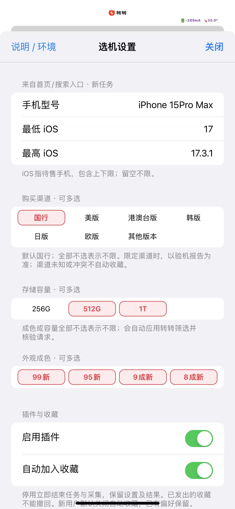
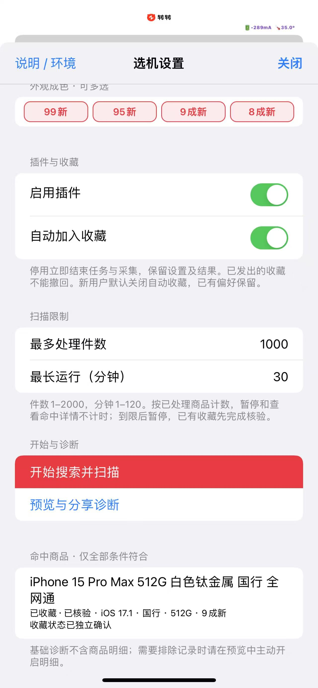
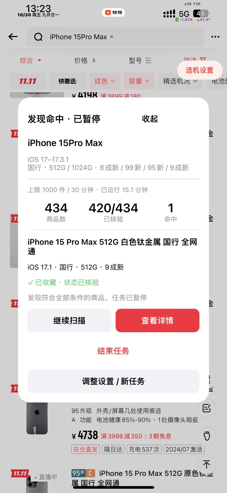
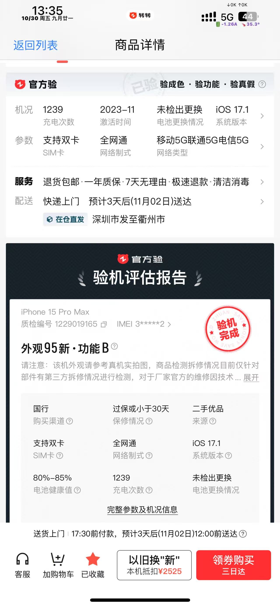

# 转转选机助手 · 1.2.0-beta9

在转转中按手机型号、待售手机 iOS 版本、购买渠道、容量和成色筛选商品，命中后暂停供你查看，并可按开关自动加入收藏。

**[下载 beta9 安装文件](https://github.com/bingdilian/zz-picker/releases/tag/v1.2.0-beta9)** · [版本记录](docs/public/CHANGELOG.md) · [问题反馈](docs/public/feedback.md)

> **目前仅使用 TrollFools 注入 `.dylib` 文件完成真机测试。** 其余格式虽然已生成并通过本地构建检查，仍需使用者自行测试安装、加载和运行。长时间运行会导致手机发热，介意请勿使用。

## 功能介绍

- **搜索与筛选**：在“选机设置”输入型号，设置最低 / 最高 iOS，选择购买渠道、存储容量和外观成色，从首页或商品列表发起任务。
- **读取验机报告**：保留商品列表界面，逐件读取报告中的系统版本等信息，按 iOS → 购买渠道 → 容量 → 成色核验。各条件组需同时满足；同组多选满足任一即可。
- **任务进度**：显示已加载的去重商品数、已核验数、命中数及暂停原因。支持暂停、继续、结束，以及处理件数和有效运行时间上限。
- **命中后查看**：发现符合条件的商品后暂停，可打开详情核对；返回列表后手动继续扫描。
- **自动加入收藏**：开启后，对确认命中且未收藏的商品尝试收藏，回读确认后才计入成功。无法确认的商品显示待确认，不反复自动点击；beta9 修复了待确认后一直阻塞后续收藏的问题。
- **设置与诊断**：关闭设置时保存有效配置；悬浮入口支持拖动；诊断先预览、再由使用者主动分享。

输入的 iOS 范围是**待售手机的系统版本**，不是运行插件手机的系统。上下限均包含端点，留空的一侧不设限制；插件逐件比较报告版本，不会从最低版本开始逐个搜索 iOS 版本。v1 不会自动根据机型计算巨魔或越狱兼容范围。

## 使用说明

### 1. 选择下载文件

请在 Release 的 **Assets** 中下载。一个转转 App 只安装或注入一种 ZZPicker，勿同时使用多个格式或版本。

| 下载文件 | 用途与操作 | 真机验证情况 |
|---|---|---|
| [ZZPicker-1.2.0-beta9-trollfools.dylib](https://github.com/bingdilian/zz-picker/releases/download/v1.2.0-beta9/ZZPicker-1.2.0-beta9-trollfools.dylib) | 在 TrollFools 中选择转转，导入并注入动态库 | **本次实际测试方式** |
| [ZZPicker-1.2.0-beta9-trollfools.zip](https://github.com/bingdilian/zz-picker/releases/download/v1.2.0-beta9/ZZPicker-1.2.0-beta9-trollfools.zip) | 内含 `ZZPicker.dylib`；可先解压，再按 dylib 步骤注入。若工具支持直接导入压缩包，也只导入这一种 | 压缩包直接导入流程未实测 |
| [ZZPicker-1.2.0-beta9-rootless.deb](https://github.com/bingdilian/zz-picker/releases/download/v1.2.0-beta9/ZZPicker-1.2.0-beta9-rootless.deb) | 普通 Dopamine 无根环境，通过该环境的包管理器安装 | 未实测，需自行测试 |
| [ZZPicker-1.2.0-beta9-roothide.deb](https://github.com/bingdilian/zz-picker/releases/download/v1.2.0-beta9/ZZPicker-1.2.0-beta9-roothide.deb) | Dopamine RootHide 环境，通过该环境的包管理器安装，并按环境规则允许转转加载插件 | 未实测，需自行测试 |
| [ZZPicker-1.2.0-beta9-release.zip](https://github.com/bingdilian/zz-picker/releases/download/v1.2.0-beta9/ZZPicker-1.2.0-beta9-release.zip) | 全部格式、说明、源码与校验清单的合集；解压后只选适合自身环境的一种安装文件 | 合集本身不能直接注入 |
| [ZZPicker-1.2.0-beta9-source.zip](https://github.com/bingdilian/zz-picker/releases/download/v1.2.0-beta9/ZZPicker-1.2.0-beta9-source.zip) / GitHub 的 `Source code` 压缩包 | 开发者阅读、修改及构建源码使用 | 不是手机安装包 |
| [SHA256SUMS](https://github.com/bingdilian/zz-picker/releases/download/v1.2.0-beta9/SHA256SUMS) / [release.zip.sha256](https://github.com/bingdilian/zz-picker/releases/download/v1.2.0-beta9/ZZPicker-1.2.0-beta9-release.zip.sha256) | 下载完整性校验；后一文件用于校验完整合集 | 无需安装或注入 |

### 2. TrollFools 注入 dylib（已实测）

1. 下载上表的 `trollfools.dylib` 并保存到手机“文件”。升级前先结束任务，完全关闭转转。
2. 打开 TrollFools，选择转转。如果已经注入旧版 ZZPicker，先在该 App 的插件管理中移除旧版，避免重复加载。
3. 导入下载的 `ZZPicker-1.2.0-beta9-trollfools.dylib`，完成注入。
4. 完全关闭并重新打开转转，确认出现“选机设置”入口。
5. 打开“说明 / 环境”，核对插件版本、转转版本及编译变体。首次使用建议先关闭自动收藏，验证搜索和报告结果后，再开启测试。

使用 `trollfools.zip` 时，可先在“文件”中解压出 `ZZPicker.dylib`，然后执行同样步骤；不要把完整合集、源码压缩包或 `.deb` 当作 dylib 导入。本次实测记录使用的是直接下载的 `.dylib`。

### 3. deb 安装（未实测）

1. 先确认自己属于普通 Dopamine **rootless**，还是 Dopamine **RootHide**，下载对应的 `.deb`，不要混装。
2. 结束任务并完全关闭转转；如原来通过 TrollFools 注入过 ZZPicker，先移除该注入。
3. 用该越狱环境的文件管理器将 deb 交给包管理器安装，按提示处理依赖或重新载入要求；RootHide 用户还需按其环境规则允许转转加载插件。
4. 重开转转，在“说明 / 环境”检查是否正确加载。先验证设置入口和只读扫描，再单独验证收藏。
5. 若无法加载或出现异常，通过原包管理器卸载并重开转转，记录环境后反馈。

**以上是对应包的使用方法，不代表已完成真机验证。rootless、RootHide 的安装和运行实践需要使用者自行测试。** 插件不会扩大越狱或注入工具本身支持的设备、系统范围。

### 4. 设置与扫描

1. 在首页或商品列表轻点“选机设置”，输入完整手机型号，例如 `iPhone 15 Pro Max`。
2. 设置待售手机的 iOS 范围，例如 `17` 至 `17.3.1`。购买渠道默认国行；购买渠道、容量和成色均可多选，同一组全不选表示不限。
3. 设置处理件数和运行时长。默认 **100 件 / 15 分钟**，可设置范围为 **1–2000 件 / 1–120 分钟**。截图中的 1000 件 / 30 分钟是测试者的自定义值。
4. 确认“启用插件”开启，按需设置“自动加入收藏”。新用户自动收藏默认关闭，升级保留已保存的选择；关闭设置会校验并保存，已有任务沿用启动时的条件。
5. 点“开始搜索并扫描”，插件按配置执行搜索、应用容量和成色筛选，再逐件核验报告。保持转转在前台，等待加载时不要手动干预页面。
6. 命中后任务暂停，核对商品与收藏状态。可点“查看详情”；返回后需手动点“继续扫描”。也可直接继续或结束任务。
7. 达到件数或有效运行时间上限后暂停，需要新建任务。暂停和查看命中详情不计入有效运行时间；“结束任务”保留结果，“启用插件”关闭则停止任务和采集。

不需要配置 HTTP Catcher、抓包证书或提供账号凭据。更多操作细节见[安装与使用](docs/public/install.md)。

## 真机实践

### 实际运行环境

| 项目 | 本次记录 |
|---|---|
| 运行插件的真实手机 | **iPhone 13 Pro Max** |
| 运行手机的 iOS | **15.4.1** |
| 转转 App 版本 | **12.8.5** |
| 插件版本 | **1.2.0-beta9** |
| 注入工具与文件 | **TrollFools，直接注入 `ZZPicker-1.2.0-beta9-trollfools.dylib`** |
| 记录日期 | 2026-10-30 |
| 证据来源 | 使用者提供的本次截图及“运行正常、收藏可用”的反馈；运行环境沿用此前诊断记录 |

**测试手机是 iPhone 13 Pro Max；截图中搜索的 iPhone 15 Pro Max 是待售目标机型。** 商品报告中的 iOS 17.1 同样是待售商品的报告值，不是测试手机的系统版本。

本次条件为：搜索 iPhone 15 Pro Max，iOS 17–17.3.1，国行，512G / 1T，成色四项全选，自动收藏开启。任务截图显示：已加载 **434** 件、已核验 **420/434**、命中 **1** 件，有效运行约 **15.1 分钟**，命中商品显示“**已收藏 · 状态已核验**”；设置结果页也显示收藏状态已独立确认，详情底部显示“已收藏”。这是一次实际使用记录，并非所有设备、格式或商品路径的通用保证。

### 实际截图

| ① 型号、iOS 与筛选条件 | ② 收藏开关、运行上限与命中记录 |
|---|---|
|  |  |

| ③ 命中暂停与收藏核验成功 | ④ 商品详情及已收藏状态 |
|---|---|
|  |  |

截图为使用者提供的原始记录。任务卡与详情报告中的成色文案存在差异，本次成色四项全选，不能用这组截图证明单一成色筛选的准确性；该项仍需单独核对。

## 其他注意事项

- **目前仅使用 TrollFools 注入 dylib 完成真机测试。** TrollFools 压缩包直接导入、rootless deb、RootHide deb 以及其他机型、iOS、转转版本，均需自行测试使用。arm64 / 最低部署 iOS 15.0 是编译条件，不等于所有 iOS 15 及以上设备均可运行。
- **长时间运行会导致手机发热，介意请勿使用。** 连续扫描和读取报告也会增加耗电；出现明显发热时请暂停或结束任务，减少处理件数与运行时间。
- 转转需保持前台；切出、锁屏或干预页面会暂停。搜索、筛选、详情结构发生变化时，可能需要重新适配。
- 自动收藏仅在回读确认后记为成功。状态未知时请手动核对，不要反复启动或重复点击；重开 App 前后都应检查未知商品。停止或卸载不能撤回已发出的收藏。
- **平台焕新电池等二次确认弹窗尚未自动处理。** 当前普通收藏成功记录不代表所有二次确认路径均通过，遇到提示需人工处理。
- 筛选依赖平台报告数据，无法远程保证实物系统、机况或报告完全准确；购买前请自行核验。任何自动操作都不能承诺平台风控或账号风险为零。
- 插件不自动上传诊断。分享前先预览，不要上传账号密码、Cookie、Token、完整抓包、地址或其他个人信息。

## 后续问题与反馈

后续重点验证其他机型与安装格式、连续翻页与超时恢复、单一成色的字段一致性，以及平台焕新电池的收藏二次确认流程。巨魔 / 越狱兼容性筛选与机型选择器在 [v2-compatibility](https://github.com/bingdilian/zz-picker/tree/v2-compatibility) 分支开发，**尚未包含在 beta9**。

发现问题时，请在 [v1 问题反馈表单](https://github.com/bingdilian/zz-picker/issues/new?template=v1-bug-report.yml) 或原讨论中提供：实际手机型号、iOS、转转版本、插件版本、注入工具与文件格式、复现步骤、暂停提示，以及预览检查后的诊断。收藏异常先核对转转收藏页，再反馈，详见[反馈说明](docs/public/feedback.md)。

开发者可使用 Mac 上的 Xcode、Python 3 和 Node.js 执行 `make check`；界面检查使用 `make ui-tests`。本地检查和模拟器结果不替代上述真机实践。

## 许可证

本项目源码采用 [MIT License](LICENSE)。允许使用、修改、分发、商业使用及闭源衍生；分发时须保留版权及许可声明。软件按原样提供，不作担保。转转 App、商标及截图中的第三方内容不在本项目源码的授权范围内。
